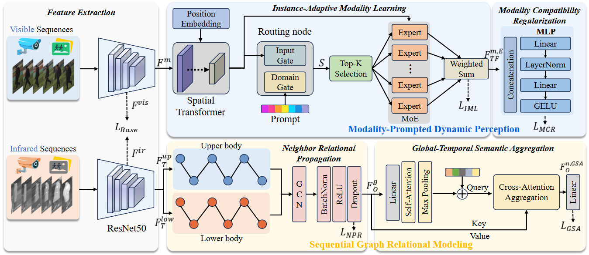

# Dynamic Modality-Temporal Adaptation for Video-based Visible–Infrared Person Re-Identification

This is the official repository for **DMTA**, a novel framework designed for **Video-Based Visible-Infrared Person Re-Identification**.





---

## 🚀 Getting Started

### 📁 Dataset 

This project supports two benchmark datasets for Video-based Visible-Infrared Person Re-Identification: **VCM** and **BUPT**.

- 📂 [VCM Dataset Download & Processing Instructions](https://github.com/VCM-project233/MITML)

- 📂 [BUPT Dataset Download & Processing Instructions](https://github.com/dyhBUPT/BUPTCampus)


### 🏋️‍♂️ Training

To train DMTA on the **VCM** dataset:

```
python train.py
```

The dataset path is configured in the `data_manager.py` file

To train DMTA on the **BUPT** dataset:

```
python train.py --data_root ../datasets/BUPTCampus/DATA/
```

### :car:Evaluation

To evaluate the model on the **VCM** dataset:

```
python test.py --resume v2t_map_best.pth
```

To evaluate the model on the **BUPT** dataset:

```
python test.py --resume v2t_map_best.pth
```


### 💾 Pretrained Models & Training Logs

We provide pretrained DMTA checkpoints and training logs for the HITSZ-VCM and BUPTCampus datasets.

| Dataset | Pretrained Weights | Training Log |
| :--- | :--- | :--- |
| HITSZ-VCM | [Download checkpoint](https://pan.baidu.com/s/1xfUaZyEkpNX2U0QgXWWFSw?pwd=c2x8) | [View training log](HITSZ-VCM/VCM_v1_os.txt) |
| BUPTCampus | [Download checkpoint](https://pan.baidu.com/s/1thafrDX8OrLdAqp-O0HyEA?pwd=m6m3) | [View training log](BUPTCampus/BUPTCampus_drop_0.2_4_16_lr_0.1_seed_1234_os.txt) |

## 📬 Contact

If you have any questions about DMTA or this repository, please feel free to contact us. For code requests related to Re-ID, please contact the email(s) below:

- **Yong Wu** — [wuyong_tj@163.com](mailto:wuyong_tj@163.com)
- **Zijie Ding** — [zijie@ahnu.edu.cn](mailto:zijie@ahnu.edu.cn)